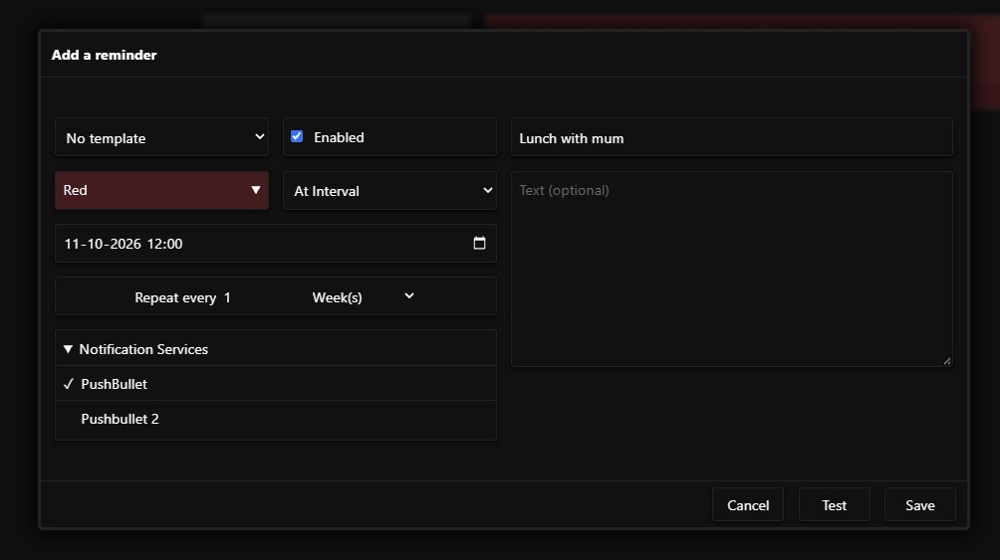

# How To Use

This is a guide to using MIND, after installation and setup.

## Creating an account

If you don't have an account yet, you can create one on the login page. Click on `Or create an account` to start creating one. If you do not see that option, then the administrator disabled registration. Only the administration can make an account for you then.

## Adding a notification service

A notification service is a way of sending a notification. For example an e-mail to a group of people or a PushBullet notification to a specific device. What the actual content of the notification is, is decided by the title and text of the reminder. The notification service only specifies in which way the title and text is sent. You set it up once, and then you can select it when creating a reminder. You can select one or more notification services for each reminder.

Go to the "Notification Services" tab in the web-UI and click the `+` button. Choose a platform, enter the required information and give the service a name. From then on, you can select the notification service when creating/editing a reminder.

## Adding a reminder

There are two types of reminders: time dependent reminders ('normal reminders') and time independent reminders ('static reminders'). Then there are also 'templates', which you can use to create normal and static reminders faster.

### Normal Reminders

Normal reminders require a time that they need to be triggered on. By default, normal reminders are 'single-use' and disappear after they are triggered. However, it's also possible to have reminders repeat.

One of the ways a reminder can repeat is based on an interval like every 5 days or once per year. The first time the reminder will be sent is on the set time. The interval will then be added and the resulting time will be the next time the reminder will be triggered. Instead of repeating based on a certain time interval, it is also possible to repeat based on the week days. For example, if you select 'Mo' and 'Thu', the reminder will be triggered every Monday and Thursday. The time is based on the time set. The date of the time set decides when the reminder starts repeating. Lastly, you can supply your own Cron schedule that the reminder should follow.

In the UI, select the tab 'Reminders' and click the '+' button to add a new reminder.

1. You can select a template to build upon. More info on that in the ['Templates' section](#templates).
2. Select whether the reminder should be enabled. If the reminder is disabled, it will not be triggered.
3. Select a colour that the reminder should have.
4. Then use the dropdown to select whether the reminder is single-use or whether it should repeat. Then fill in the fields below it, based on what option you chose, to specify when and how often the reminder should trigger.
5. At the bottom, select which notification service(s) should be used when sending the reminder.
6. At the right side, give a title for the reminder and optionally a body/text.
7. Clicking the 'Test' button will send the reminder, so that you can check if it works as desired. Then click 'Add' to finalise the creation.

Once it's added, the timer is set! When the set time is reached, the reminder will be sent.

### Static Reminders

Static reminders work the same way as normal reminders, except that there is no time aspect. There is no date, time or repetition. This is because static reminders are only triggered manually. Simply click on the reminder in the library and click the 'Trigger' button to send the reminder.

The use of this is to notify people on command. For example, a notification to your kids that you'll be late. You don't want to send such a thing on a certain time or interval, but instead on command. Or an e-mail to your team notifying them of a emergency meeting. With static reminders, you can set it up once and when needed click one button to notify everyone within seconds.

### Templates

Templates can be used to make it easier to create (static) reminders by filling in fields when selecting it. In the UI, select the 'Templates' tab and click the '+' button to add a template. Templates can store the colour, title, notification service selection and body/text of the reminder. When saved, you can start using it in the creation of reminders. Simply select the template from the list and all the fields will be filled automatically. The only fields left are the time fields for normal reminders.
